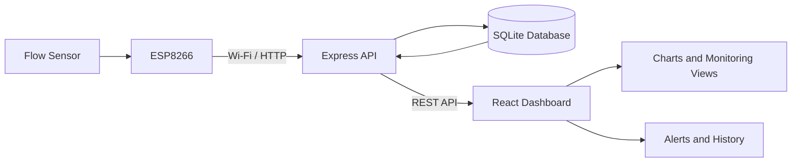

# AquaSense 💧
### Smart Water Leakage Detection & Predictive Monitoring System

AquaSense is an IoT-based water pipeline monitoring project designed to help observe water flow, track consumption, and identify abnormal usage patterns that may indicate leakage.

The project combines a web dashboard, a lightweight backend, and a microcontroller-based sensing prototype. It is being developed as a college Project-Based Learning (PBL) project.

> **Project status:** Active development. The repository contains a React dashboard, an Express/SQLite backend, and a firmware workspace. Hardware integration and individual dashboard features may be at different stages of implementation; see the status notes below.

---

## Contents

- [Overview](#overview)
- [Project goals](#project-goals)
- [System architecture](#system-architecture)
- [Technology stack](#technology-stack)
- [Repository structure](#repository-structure)
- [Features and implementation status](#features-and-implementation-status)
- [Hardware](#hardware)
- [Getting started](#getting-started)
- [Configuration](#configuration)
- [API](#api)
- [Operating modes](#operating-modes)
- [How data flows](#how-data-flows)
- [Team](#team)
- [Roadmap](#roadmap)
- [Contributing](#contributing)
- [License](#license)

## Overview

Water leakage in pipelines can lead to wasted water, higher bills, and damage to infrastructure. AquaSense explores a low-cost monitoring approach using a flow sensor and an ESP8266-based device to collect readings and make them available to a dashboard.

The long-term goal is to provide a clear view of pipeline activity, consumption trends, device health, and unusual flow behaviour from one place.

## Project goals

- Monitor water flow from a connected sensor.
- Record readings through a backend service.
- Visualize flow and consumption information in a web dashboard.
- Highlight unusual readings that may require attention.
- Provide a simulation path for development and demonstration when physical sensor data is unavailable.
- Build a foundation that can later support additional sensors and predictive analysis.

## System architecture



The intended data path is:

1. A flow sensor produces pulses as water moves through the pipe.
2. The ESP8266 firmware converts pulse counts into a flow reading.
3. The device sends readings over Wi-Fi to the backend API.
4. The backend stores readings in SQLite.
5. The React frontend requests and displays the available data.

The diagram represents the intended system flow. Exact endpoint behaviour and hardware connectivity should be verified against the current implementation before deployment.

## Technology stack

| Layer | Technologies |
|---|---|
| Frontend | React 19, Vite 8 |
| Charts and icons | Recharts, Lucide React |
| Backend | Node.js, Express 5 |
| Database | SQLite with better-sqlite3 |
| Device / firmware | ESP8266, Arduino-compatible firmware |
| Communication | Wi-Fi, HTTP / REST |

## Repository structure

```text
PBL-2/
├── aquasense/              # React + Vite frontend
│   ├── firmware/           # ESP8266 firmware workspace
│   ├── public/              # Static frontend assets
│   ├── src/                 # React application source
│   ├── package.json
│   └── vite.config.js
├── backend/                 # Express API and database layer
│   ├── ml_service/          # Service workspace for analysis / ML
│   ├── src/                 # Backend source code
│   └── package.json
├── .gitignore
└── README.md
```

## Features and implementation status

The repository is organized around these dashboard and system areas:

| Area | Purpose |
|---|---|
| Overview | At-a-glance monitoring dashboard |
| Live Monitoring | Current sensor readings and charts |
| Consumption | Water usage and consumption views |
| Pipeline Network | Pipeline monitoring context |
| Events and Alerts | Surface events and potentially abnormal readings |
| History and Reports | Review historical data |
| Device Health | Inspect device and sensor status |
| Settings | Configure application behaviour |
| AI Assistant / analysis | Future-facing assistance and analysis workspace |

**Implementation note:** These are project modules and intended capabilities, not a guarantee that every screen or integration is complete. Check the current source and test each workflow before presenting it as production-ready.

## Hardware

The prototype is based around the following components:

| Component | Role |
|---|---|
| ESP8266 / NodeMCU (ESP-12E) | Wi-Fi-enabled microcontroller |
| Water flow sensor | Produces pulses proportional to water flow |
| Relay module | Switching/control experiments |
| DC motor / pump | Water-flow prototype |
| Breadboard and jumper wires | Circuit prototyping |
| Power supply | Powers the prototype components |
| Silicone pipe / tubing | Carries water through the test setup |

### Example flow-sensor wiring

Use the exact pin mapping defined in the firmware you are uploading. A commonly used prototype mapping in this project has been:

| Flow sensor wire | NodeMCU connection |
|---|---|
| Red | VIN / suitable sensor supply |
| Black | GND |
| Yellow (signal) | D2 (GPIO4) or the pin configured in the sketch |

**Important:** The signal pin must match the firmware configuration. The project has also used D5 during testing, so do not assume D2 and D5 are interchangeable. Check the active sketch and sensor voltage requirements before powering the circuit. Never connect a sensor signal above the microcontroller's permitted GPIO voltage.

A pressure sensor has been considered for future expansion; do not assume it is installed in the current hardware prototype.

## Getting started

### Prerequisites

Install the following before running the project:

- Node.js and npm (use a version compatible with the installed Vite release).
- Git.
- A browser.
- Optional for hardware work: Arduino IDE, ESP8266 board support, and the required sensor libraries.

### 1. Clone your repository

```bash
git clone https://github.com/omkailasmore/PBL-2.git
cd PBL-2
```

### 2. Start the backend

Open a terminal:

```bash
cd backend
npm install
npm run dev
```

The backend start script runs `src/server.js`. Check the terminal output for the port on which the server is listening.

For a non-development run:

```bash
npm start
```

### 3. Start the frontend

Open a second terminal from the repository root:

```bash
cd aquasense
npm install
npm run dev
```

Vite prints the local development URL in the terminal (commonly `http://localhost:5173`).

### 4. Build the frontend

From the `aquasense/` directory:

```bash
npm run build
npm run preview
```

To run the configured linter:

```bash
npm run lint
```

## Configuration

Keep machine-specific settings and credentials out of source control.

If the backend uses environment variables, create a local `.env` file in `backend/` and set the values required by the current server implementation. For example:

```env
PORT=3001
```

The exact supported environment variables are determined by the backend source. Do not assume a variable is read unless it is referenced in the code.

For device firmware, configure:

- Wi-Fi network name (SSID).
- Wi-Fi password.
- Backend host address reachable from the ESP8266.
- Backend port and API route.
- Flow-sensor signal pin and calibration factor.

**Network tip:** When the ESP8266 sends data to a backend running on your laptop, use the laptop's LAN IPv4 address, not `localhost`. Both devices should be on a network that allows them to communicate. Configure the firewall to allow the backend port only as needed.

Never commit Wi-Fi passwords, API keys, personal tokens, or other secrets.

## API

The backend is an Express application and the project has used port `3001` during local development.

A health-check route has been used during development:

```http
GET /api/health
```

Sensor readings have also been posted to:

```http
POST /api/readings
Content-Type: application/json
```

The exact request schema, validation rules, response format, and available routes should be taken from the current backend source. Treat these paths as development references and verify them against `backend/src/` before integrating another client.

Example health check:

```bash
curl http://localhost:3001/api/health
```

## Operating modes

A simulation mode has been part of the dashboard development plan so that UI behaviour can be tested without relying on live hardware. A normal/live mode is intended to use actual device readings.

- **Live / normal mode:** should display readings received from the connected device and backend.
- **Simulation mode:** should use clearly labelled simulated values and must not be mistaken for real measurements.

Verify the current implementation before relying on either mode in a live demonstration.

## How data flows

1. Water moves through the flow sensor.
2. The sensor emits electrical pulses.
3. Firmware counts pulses over a time interval and applies a calibration factor.
4. The ESP8266 sends a reading to the backend over the local network.
5. The backend validates and stores the reading.
6. The frontend fetches readings and renders the available monitoring views.
7. Detection rules can be applied to flag readings that deserve investigation.

Sensor calibration depends on the exact sensor model and installation. Compare measured output with a known volume of water and adjust the firmware's calibration factor accordingly.

## Team

AquaSense is developed by Team Atlantis as a Project-Based Learning project.

| Team member | Role |
|---|---|
| Om More | Team lead and project coordination |
| Anushree Bhati | Frontend development and UI/UX |
| Gauri Pawar | Project development |
| Tejas Atkare | Project development and assigned integrations |

Roles may evolve as the project progresses.

## Roadmap

- [x] Establish React + Vite frontend workspace.
- [x] Establish Express backend workspace.
- [x] Set up SQLite as the backend data store.
- [x] Prototype ESP8266 flow-sensor data transmission.
- [ ] Validate end-to-end device-to-dashboard data flow.
- [ ] Complete and test live monitoring charts.
- [ ] Calibrate flow readings against measured water volume.
- [ ] Refine simulation and live operating modes.
- [ ] Improve alert rules and event history.
- [ ] Add deployment documentation and production configuration.
- [ ] Evaluate pressure sensing and more advanced predictive analysis.

## Contributing

This is an academic PBL project. Contributions, bug reports, and suggestions are welcome.

1. Fork the repository.
2. Create a feature branch: `git checkout -b feature/your-feature`.
3. Make focused changes and test them locally.
4. Commit with a clear message: `git commit -m "Add: your feature"`.
5. Push your branch and open a Pull Request.

Please do not commit generated folders such as `node_modules/`, local databases, build output, or secret configuration files.

## License

No explicit open-source license is currently declared in this repository. Unless a license is added, standard copyright applies and reuse or redistribution is not automatically granted.

---

<p align="center">
  Built with 💧 by Team Atlantis
  <br />
  <strong>AquaSense — Monitor smarter. Save water.</strong>
</p>
